<div align="center">

# Study Assistant · 学习助手

### 把自己的资料，建成能追问、能核查、能产出的研究助手

本地优先的个人知识库，连接文献管理、原文阅读、限定范围的 AI 问答与研究写作。

[](CHANGELOG.md)
[](https://github.com/boway033-cell/Study-assistant/actions/workflows/ci.yml)
[](docs/DOWNLOAD_AND_INSTALL.md)
[](requirements.txt)
[](frontend/package.json)

[下载与安装](https://github.com/boway033-cell/Study-assistant/releases/latest) · [产品界面与使用](#产品界面与使用) · [快捷开始](#快捷开始) · [问题反馈](https://github.com/boway033-cell/Study-assistant/issues)

</div>

## 项目简介

读过的论文、专著和工作资料会不断增加，研究问题也会不断变化。Study Assistant 帮你把这些材料留在同一个知识库：先按书架或项目组织，再沿原文阅读、追问与取证，最后把经过核对的判断整理成研究报告、Word 文稿或 PPTX 汇报。

当前产品是 **Windows 本地运行的 Web 应用**：启动本地服务后在浏览器中使用，资料默认保存在本机。没有模型密钥，也可以使用导入、阅读、标注和本地搜索；AI 功能由你配置模型连接后主动调用。

**从哪里开始：** 想先体验界面，跳到[产品界面与使用](#产品界面与使用)；准备安装，跳到[快捷开始](#快捷开始)；评估技术与数据边界，查看[技术栈与依赖](#技术栈与依赖)和[资料与隐私](#资料与隐私)。

## 核心亮点与差异化优势

**最吸引人的一点：回答与作品可以沿来源回到原页，阅读时保存的证据还能继续用于研究、写作与汇报。**

| 亮点 | 如何实现 | 对使用者的价值 |
| --- | --- | --- |
| **答案能回原文核对** | 问答引用显示书目、章节和页码，支持打开来源；研究报告提供逐条主张审计 | 判断有依据，发现疑点时有明确的核对入口 |
| **围绕自己的书架与项目研究** | 选择单本、书架或项目作为问答范围，复用有效的全文研读结果 | 持续追问同一问题时，资料范围清楚且可调整 |
| **读、问、记、写连成流程** | 批注、知识笔记、证据卡与研究报告保留来源，继续送入作品库或汇报工作区 | 阅读成果能够积累，后续成稿时继续使用 |
| **长文研读有覆盖与预算信息** | 分窗口处理已提取正文，展示逐本状态、文本覆盖和任务预算 | 能看到处理进度、资料缺口与模型用量边界 |
| **资料在本机，模型由自己选** | 本地解析与检索，多供应商连接，按任务配置首选模型和回退顺序 | 本地基础功能独立可用，AI 调用由自己管理 |
| **自己的判断由自己确认** | 个人记忆明确保存，研究档案保留竞争解释、阅读任务和复核记录 | 区分原文、个人观点和 AI 推断，支持长期修订 |

“个人助手”通过限定范围、检索原文、复用研读结果与用户确认的记录工作。添加书籍不会训练或微调底层模型；引用编号有效也不等于原文已经支持结论。

## 产品界面与使用

以下图片由当前源码构建后的应用重新截取，使用独立的**虚构演示资料库**。截图中的文献、作者、回答与稿件仅展示交互，不代表真实研究成果；问答样例没有调用云端模型。

### 1. 资料库：让材料进入同一个研究范围

导入 PDF、DOCX 或 PPTX，管理书目信息、阅读状态和书架；同一资料可以归入多个书架，便于按课程、主题或项目组织。

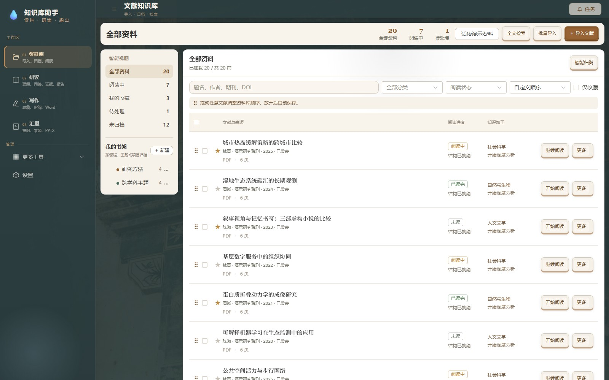

*图 1 · 资料库：左侧按书架组织，中央查看文献与处理状态。图片路径：`docs/assets/screenshots/library.jpg`。*

1. 在侧栏打开“资料库”，点击“导入文献”或“批量导入”，选择文件。
2. 打开右上角“任务”，等待解析完成；扫描 PDF 可查看 OCR 进度。
3. 新建书架，把相关资料加入其中，补全作者、年份等档案信息。
4. 首次体验也可使用“试读演示资料”，完成无需模型密钥的本地阅读流程。

### 2. 阅读器：读原文，留下能回看的记录

阅读器提供目录跳转、阅读位置记忆、高亮、划线、批注与来源定位。长书可以结合 PDF 书签、印刷目录和正文标题识别章节，识别有误时人工修订。

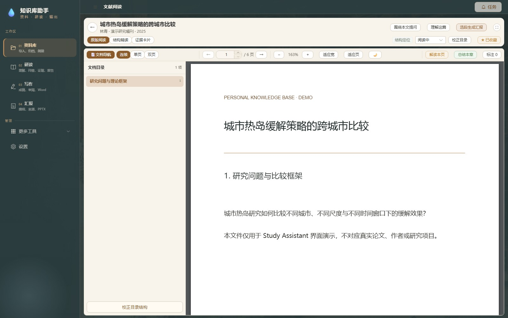

*图 2 · 原文阅读：目录与原页相邻，跳页、显示模式和标注入口集中在顶部。图片路径：`docs/assets/screenshots/reader.jpg`。*

1. 在资料列表点击“开始阅读”或“继续阅读”。
2. 通过目录或页码定位段落，选中文字做高亮、批注或笔记。
3. 对重要判断保留原页入口；目录不准确时使用“校正目录”。
4. 回到“研读 → 笔记与证据”整理记录，形成后续研究可用的材料。

<details>
<summary>查看笔记与证据界面</summary>

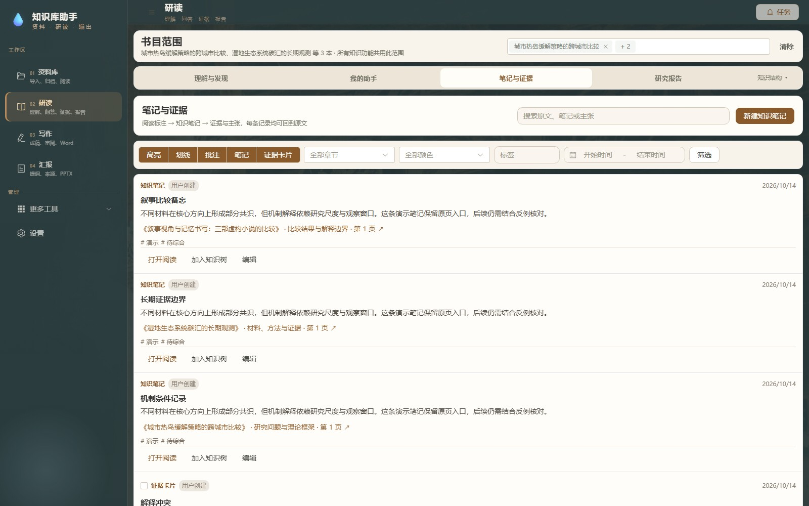

*补充图 · 笔记与证据：按所选书目汇总记录，每条知识笔记保留来源入口。图片路径：`docs/assets/screenshots/knowledge-notes.jpg`。*

</details>

### 3. 我的助手：限定资料范围，追问并核查回答

进入“研读 → 我的助手”，选择单本、书架或项目。书架和项目可以查看逐本研读状态、明确保存个人记忆，并把问题与证据加入研究档案。

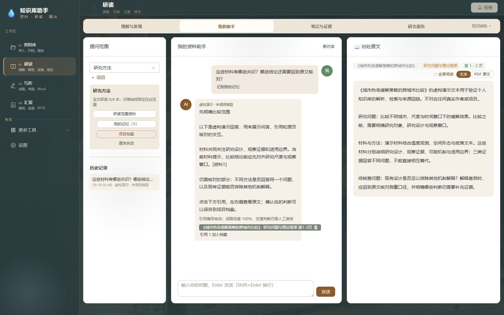

*图 3 · 我的助手：左侧选择范围，中间追问，右侧核对引用原文。画面中的回答明确标记为虚构演示。图片路径：`docs/assets/screenshots/assistant-chat.jpg`。*

1. 选择包含本次研究资料的书架，或点击“＋ 项目”引用书架和单本资料。
2. 如需全文研读，点击“研读范围资料”，检查书目、模型和预算后启动；普通问答可先使用已有检索内容。
3. 输入一个具体问题，例如：“这些材料对同一概念的定义有什么不同？”按 `Enter` 发送，`Shift+Enter` 换行。
4. 点击回答中的来源，在右侧查看原文；重点检查原文是否支持该判断。
5. 连续追问或打开历史记录继续讨论。需要长期保留时，明确保存到“我的记忆”或“项目档案”。

### 4. 研究报告：比较共识、分歧与竞争解释

进入“研读 → 研究报告”，选择书目、章节或笔记，提出研究问题。报告工作区展示分析计划、正文与来源审计；你可以逐条修订主张，保留待核查问题。

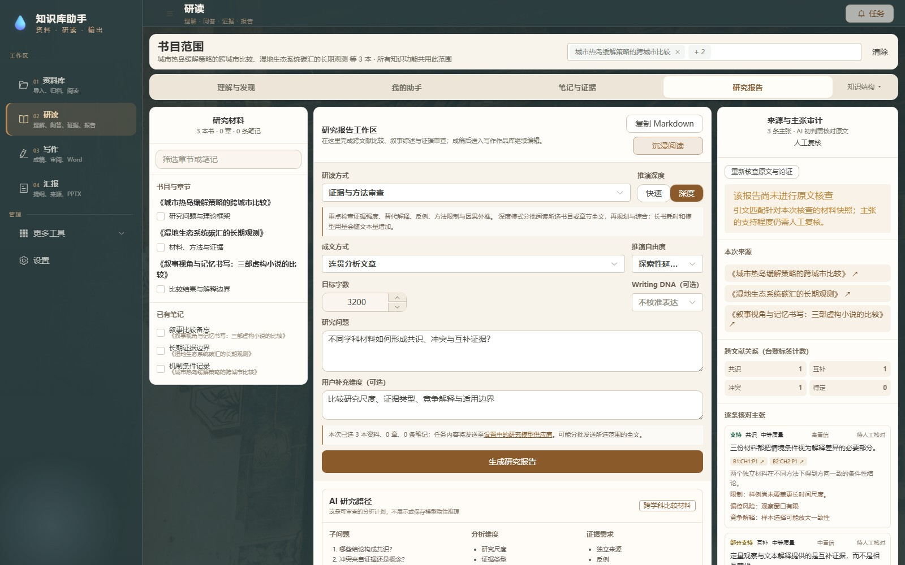

*图 4 · 研究报告：左侧限定材料，中间组织研究问题与报告，右侧核对主张和来源。图片路径：`docs/assets/screenshots/research-workspace.jpg`。*

1. 先选择研究书目，再按需要选章节或已有笔记。
2. 填写研究问题，选择研读方式、推演深度和目标字数；可补充必须比较的维度。
3. 提交前检查材料范围、模型和本次用量上限，在任务中心跟踪进度。
4. 阅读报告并逐条打开来源，检查共识、冲突、反例和竞争解释；必要时单独重试核查。
5. 保存批判性审查，或点击“继续写作 / 导出 Word”“发送到 PPTX 工作台”进入下一步。

### 5. 写作工作台：把研究结果编辑成作品

写作工作台以“新建作品”和“作品库”承接成稿、编辑、表达审阅和 Word 输出。Writing DNA 用于校准表达与结构；研究综述和跨文献比较从研究报告进入作品库继续处理。

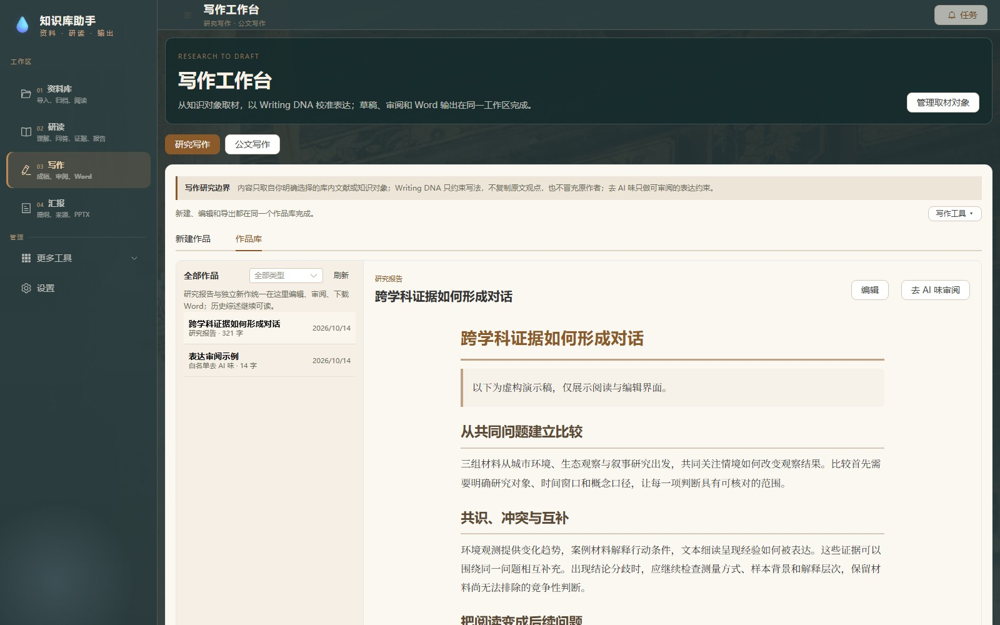

*图 5 · 作品库：左侧保留稿件记录，中央阅读正文并继续编辑、审阅和输出。图片路径：`docs/assets/screenshots/writing-output.jpg`。*

1. 从研究报告点击“继续写作 / 导出 Word”，或在写作页“新建作品”明确选择取材来源。
2. 填写题目、体裁和写作要求；如有已就绪的 Writing DNA，可选择用于表达校准。
3. 在“作品库”打开稿件，人工编辑正文、核对数字与引用。
4. 按需要执行表达审阅，逐条决定是否采用改写，再下载 Word。

<details>
<summary>查看写作风格、新建作品与表达审阅界面</summary>

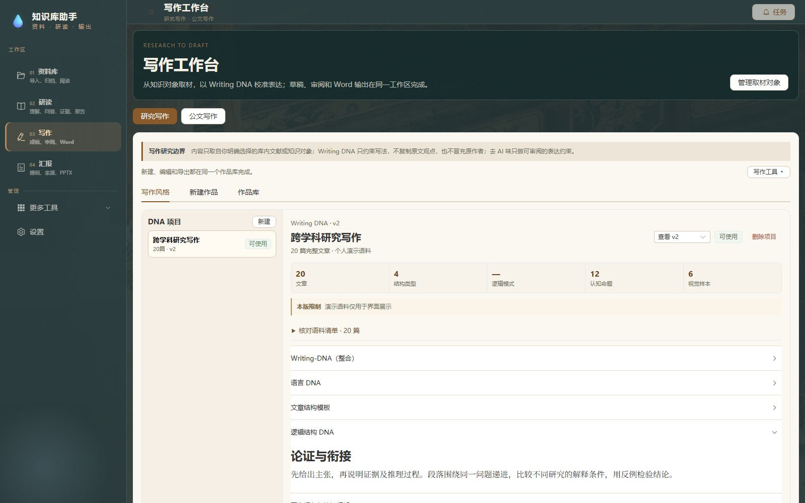

*补充图 · “写作工具 → 写作风格”：管理 Writing DNA 与版本。图片路径：`docs/assets/screenshots/writing-lab.jpg`。*

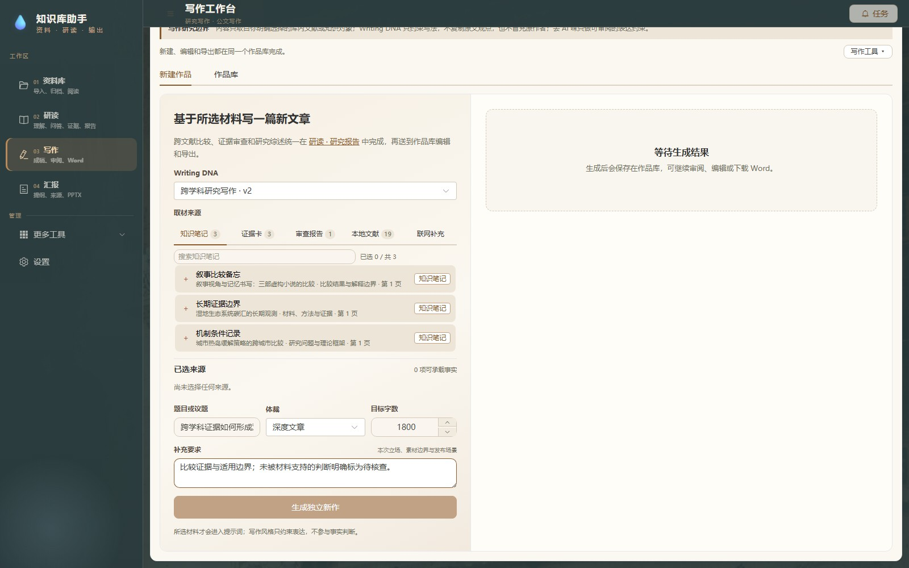

*补充图 · 新建作品：明确取材对象和本次要求。图片路径：`docs/assets/screenshots/writing-review.jpg`。*

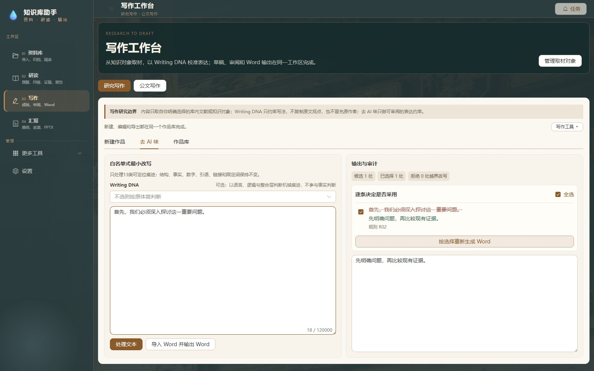

*补充图 · 表达审阅：保留原文与改写差异，由使用者决定采用哪些修改。图片路径：`docs/assets/screenshots/writing-clean.jpg`。*

</details>

### 6. 文献汇报：审提纲、核来源，再生成 PPTX

汇报工作区围绕“选择范围 → 编辑提纲 → 来源审计 → 生成与验收”展开。选中的笔记、证据卡或研究报告提供内容依据，输出为可编辑 PPTX。

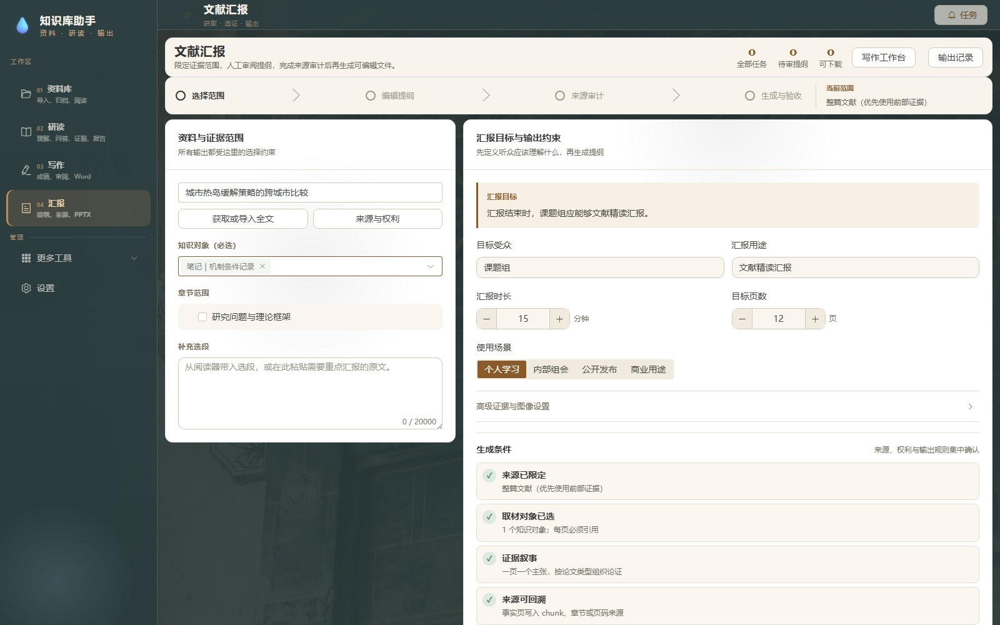

*图 6 · 文献汇报：左侧选择证据对象，右侧设定受众、时长和页数，顶部展示核心步骤。图片路径：`docs/assets/screenshots/workbench.jpg`。*

1. 选择主文献与知识对象，按需要限定章节或补充原文选段。
2. 填写受众、用途、时长和目标页数；使用来源图像时核对使用范围。
3. 生成并人工编辑提纲，检查每页主张、来源和叙事顺序。
4. 完成来源审计后生成 PPTX，在输出记录中查看结果；下载后核对图表、数字和版式。

## 交互逻辑与核心流程

核心导航按“资料库 → 研读 → 写作 → 汇报”组织。“研读”内集中理解与发现、我的助手、笔记与证据、研究报告，以及知识树和知识图谱。

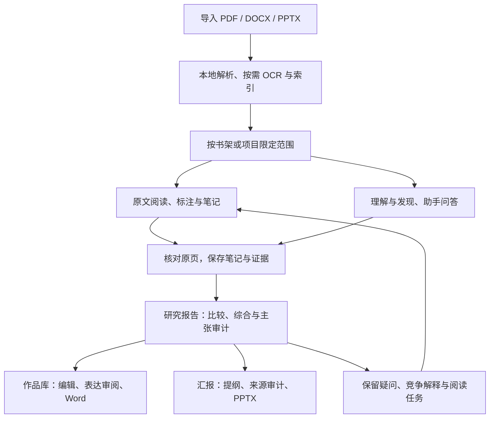

| 交互原则 | 使用时如何体现 |
| --- | --- |
| 先确定范围 | 助手使用当前单本、书架或项目；报告使用明确选择的书目、章节或笔记 |
| 来源随内容保留 | 回答、笔记、证据卡与报告提供来源定位入口，重要判断回到原页核对 |
| 原文与判断分开 | 用户保存的记录、AI 推断和原文依据分别标识，个人记忆由用户明确确认 |
| 长任务可跟踪 | 解析、OCR、研读与输出任务在任务中心查看；按任务提供取消、重试或返回工作区入口 |
| 资料变化后再复核 | 有效研读结果可复用；相关来源变化时，界面提示重新核对 |

**示例：** 把同一主题的三篇文献加入书架，阅读并记录关键定义，让助手比较概念差异；回到引用页保存证据，再生成研究报告。报告中的争议保留为后续阅读问题，已核对的部分继续进入 Word 文稿或组会 PPTX。

## 功能特性列表

| 模块 | 当前能力 |
| --- | --- |
| 资料管理 | PDF / DOCX / PPTX 导入、书架与项目、书目信息、收藏、阅读状态、排序、OCR 和目录修订 |
| 原文阅读 | PDF / Office 文档阅读、目录跳转、阅读位置记忆、高亮、划线、批注与来源回跳 |
| 检索问答 | 本地全文搜索、可选向量检索、限定范围问答、连续追问、对象澄清与历史记录 |
| 理解与发现 | 全文研读、论证地图、两篇文献概念对齐、解释张力与候选问题 |
| 知识沉淀 | 知识笔记、证据卡、个人记忆、研究档案、知识树与知识图谱 |
| 研究报告 | 跨文献共识 / 冲突 / 互补分析、研究计划、主张与来源审计、人工复核及结果回存 |
| 写作输出 | 新建作品、作品库、Writing DNA、表达审阅、Word 输出与公文写作入口 |
| 文献汇报 | 选择知识对象、提纲编辑、来源审计、可编辑 PPTX 与输出记录 |
| 维护与设置 | 知识库健康检查、知识库洞察、模型连接、任务路由、用量预算和安装诊断 |
| 学习工具 | 自测等补充入口，服务阅读与知识整理 |

## 适用场景

| 场景 | 推荐用法 | 可形成的成果 |
| --- | --- | --- |
| 课程学习与长书精读 | 按课程建书架，校对目录，标注原文并针对概念追问 | 带来源的学习笔记、知识结构与自测材料 |
| 课题研究与论文准备 | 按研究问题建项目，比较定义、方法、证据与反例 | 研究档案、阅读任务、可审查的研究报告 |
| 文献综述与跨学科比较 | 明确书目范围，比较共识、分歧和概念口径 | 个人知识库范围内的综述草稿与主张台账 |
| 教师备课与组会汇报 | 从笔记、证据卡或报告选择内容，编辑汇报提纲 | 有来源的讲解材料和可编辑 PPTX |
| 工作资料整理与长期写作 | 按主题归档，明确保存判断，反复修订作品 | 持续积累的知识库与 Word 文稿 |

适合已有一批资料、需要长期阅读和产出的学生、教师、研究者与知识工作者。跨文献分析覆盖本次选定材料；系统综述仍需另行完成全面检索、纳排标准与质量评价。

## 快捷开始

### 环境要求

| 使用方式 | 必需环境 |
| --- | --- |
| Release 应用包 | Windows 10/11、64 位 Python 3.12+、现代浏览器；完整应用包包含前端构建产物 |
| 源码安装 | 上述环境，加 Git、Node.js 22+ 和 npm |
| AI 功能 | 可用的模型供应商连接与网络；API Key 在设置中配置 |

### 普通用户：下载并运行

1. 打开 [Releases](https://github.com/boway033-cell/Study-assistant/releases/latest)，下载实际提供的 `study-assistant-v*.zip` 应用附件，完整解压到固定目录，例如 `D:\Apps\Study-assistant`。若暂无应用附件，使用下方源码方式。
2. 双击 `install.bat`。向导会建立虚拟环境、安装依赖并启动应用；中断后再次运行可继续。
3. 日常双击 `start.bat`，或使用向导创建的“打开学习助手”桌面入口；退出服务运行 `stop.bat`。

### 源码用户：一键安装

在 PowerShell 中执行：

```powershell
git clone https://github.com/boway033-cell/Study-assistant.git
cd Study-assistant
.\install.bat
```

向导在缺少 `frontend/dist` 时自动构建前端。启动器在 `127.0.0.1:8000–8010` 中选择可用端口，健康检查后打开实际页面；固定的 `http://127.0.0.1:8000` 不能唤醒未启动的服务。

### 手动安装与运行

以下命令从克隆后的项目根目录执行：

```powershell
python -m venv .venv
.\.venv\Scripts\python.exe -m pip install --upgrade pip
.\.venv\Scripts\python.exe -m pip install -r requirements.txt
cd frontend
npm ci
npm run build
cd ..
.\start.bat
```

停止服务：

```powershell
.\stop.bat
```

### 配置 AI，完成第一次体验

本地阅读可直接开始。使用 AI 前，在“设置 → 模型连接”添加供应商连接，填写 API Key、Base URL 和模型名，检测连接后配置各任务使用的模型。

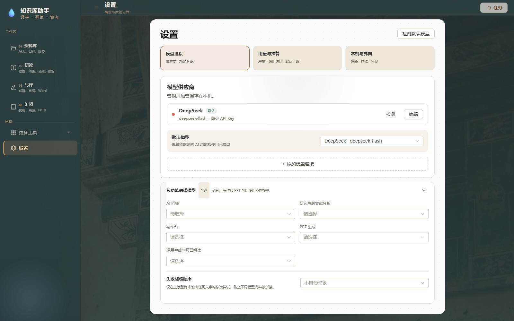

*图 7 · 模型连接：管理供应商和默认模型，各任务通过功能分配选择连接。截图使用无密钥的独立演示环境。图片路径：`docs/assets/screenshots/model-settings.jpg`。*

1. 添加并检测连接，再检查问答、研究、写作和 PPTX 的任务路由。
2. 按需要单独配置视觉模型；在“用量与预算”设置上限和供应商费率。
3. 导入一份测试资料，确认解析完成，阅读并做一条批注。
4. 在“我的助手”选择这份资料或其书架，提问后打开引用核对。

`.env` 是可选配置，支持项见 [.env.example](.env.example)；日常模型管理推荐在界面完成。更新或迁移前先停止服务，再运行 `scripts\maintenance\backup.bat` 备份实际数据目录（自动解析 `DATA_DIR` 并校验压缩包与数据库完整性）；未使用自定义 `DATA_DIR` 时也可以复制整个 `backend/data/`。完整步骤见[下载与安装指南](docs/DOWNLOAD_AND_INSTALL.md)。

## 技术栈与依赖

| 层次 | 技术与依赖 | 用途 |
| --- | --- | --- |
| 前端 | Vue 3、Vue Router、Vite、Element Plus、Axios | 浏览器界面、导航、构建与 API 调用 |
| 阅读与可视化 | PDF.js、ECharts、Marked、DOMPurify | PDF 阅读、知识可视化与安全的 Markdown 展示 |
| 后端 | Python、FastAPI、Uvicorn、本地任务队列 | API 服务、任务进度与前端静态资源托管 |
| 数据与检索 | SQLite、SQLAlchemy、aiosqlite、FTS5、jieba | 本地持久化与中文全文检索 |
| 文档处理 | PyMuPDF、pdftext、python-docx、python-pptx | PDF / DOCX / PPTX 解析与文档输出 |
| OCR | RapidOCR、ONNX Runtime | 扫描页按需文字识别 |
| 模型连接 | HTTPX、OpenAI 客户端、多供应商适配器、cryptography | 任务路由、模型请求与本机密钥保护 |
| 可选增强 | fastembed + ChromaDB、PP-DocLayout-M | 向量检索与版面分析，需要额外依赖或模型准备 |

Python 运行依赖及锁定版本见 [requirements.txt](requirements.txt)，前端依赖见 [package.json](frontend/package.json) 和 [package-lock.json](frontend/package-lock.json)，测试依赖见 [requirements/dev.txt](requirements/dev.txt)。向量检索默认关闭；标准安装无需部署独立向量数据库服务。

DOCX / PPTX 的高保真预览和 PowerPoint 逐页视觉验收需要本机 Office 或兼容渲染环境。PPTX 文件生成本身不依赖 PowerPoint；无法自动化验收时需在办公软件中打开核对。

<details>
<summary>开发运行与验证命令</summary>

安装完成后，开发模式使用两个终端，均从项目根目录开始。先停止启动器运行的实例，确保后端使用开发代理对应的 8000 端口。

终端 1：

```powershell
.\.venv\Scripts\python.exe -m uvicorn backend.app.main:app --host 127.0.0.1 --port 8000 --reload
```

终端 2：

```powershell
cd frontend
npm run dev
```

打开 `http://localhost:5173`；Vite 将 `/api` 代理到后端 8000。前端修改后重新执行 `npm run build`，再通过启动器使用构建后的页面。

验证命令从项目根目录执行：

```powershell
.\.venv\Scripts\python.exe -m pip install -r requirements/dev.txt
.\.venv\Scripts\python.exe -m pytest backend\tests -q
cd frontend
npm run test:unit
npm run build
```

如通过反向代理部署在自有域名，在 `CORS_ALLOWED_ORIGINS` 填写完整站点源，例如 `https://study.example`，并让代理保留原始 `Host`。本机默认源已内置。

</details>

## 资料与隐私

| 操作 | 数据去向 |
| --- | --- |
| 导入、解析、OCR、阅读、批注与本地检索 | 默认在本机处理，资料保存在 `backend/data/` |
| 主动运行 AI 问答、研读、研究、写作或汇报 | 任务需要的文字发送给所配置的模型供应商 |
| 主动解读页面图像 | 所选页面图像发送给配置的视觉模型供应商 |
| 主动使用 Crossref 检索或开放获取导入 | 访问相应外部服务；Crossref 接收检索词及配置的联系邮箱 |

API Key 与原始文件默认留在本机；全文研读可能分批发送所选资料的全部**已提取文字**。提交前核对材料、模型和用量，实际费用以供应商账单为准。详细边界见[隐私说明](PRIVACY.md)。

## 常见问题

### 没有 API Key 能使用吗？

可以使用本地导入、解析、阅读、标注与全文搜索，也能加载虚构演示资料。问答、AI 研读和 AI 生成需要相应模型连接；主动使用外部文献检索或开放获取仍会联网。

### 双击启动后页面没打开，或提示连接被拒绝？

先运行 `start.bat`，让启动器选择实际地址。运行 `diagnose.bat` 检查安装环境，查看 `backend/data/runtime/launcher.log` 与 `server.err.log`。关闭浏览器不会停止后端，需要停止时运行 `stop.bat`。

### 模型检测成功，为什么某个 AI 功能仍不可用？

连接检测和任务路由分别配置。进入“设置 → 模型连接”，检查默认模型、功能分配及回退顺序；页面图像解读还需单独配置视觉模型。

### OCR 慢、目录不准确或有页面缺少文字怎么办？

在任务中心查看页级进度与错误，按需要取消或重新解析；在阅读器对照原页并修订目录。“全文研读完成”只代表已处理可提取文本，不代表覆盖所有图像、公式或未识别页面。

### 带引用的回答、研究报告可以直接采用吗？

重要判断先回到原页检查。引用位置、词面筛查和原文对结论的支持程度是不同问题；目录、OCR、论证关系与 AI 解释都可能出错。研究报告先保存正文，再独立核查原文与论证，核查失败可单独重试。

### Word 或 PPTX 预览失败怎么办？

先确认本机 Office 或兼容渲染环境是否可用。缺少 PowerPoint 自动化时，PPTX 可以生成，但会标记验收降级；下载后在办公软件中核对版式、图表、公式与来源。

### 如何备份或迁移资料？

先运行 `stop.bat`，再执行 `scripts\maintenance\backup.bat`。脚本按实际 `DATA_DIR`（环境变量 > 仓库根 `.env` > 默认 `backend/data`）生成经校验的 `backup-*.zip`；数据目录不存在、压缩或校验失败时会以非零退出码结束。也可以停止服务后复制整个实际数据目录。迁移到新目录或新电脑后重建依赖；不要只复制数据库，原文、输出与索引同样需要保留。

## 反馈与参与

- **问题与建议：** 在 [GitHub Issues](https://github.com/boway033-cell/Study-assistant/issues) 提交 Bug、功能建议或使用反馈。
- **复现信息：** 提供项目版本、Windows / Python 版本、操作步骤、预期与实际结果，以及脱敏截图或日志。涉及文档解析时，可附有处理权限的最小样本。
- **代码贡献：** 阅读[贡献指南](CONTRIBUTING.md)，通过 Pull Request 提交改进。
- **安全问题：** 按[安全策略](SECURITY.md)指定的渠道报告。

<details>
<summary>展示图片维护清单与重拍方式</summary>

README 中的图片就近放在对应功能说明下，使用仓库相对路径，可直接在 GitHub 项目主页显示。后续更新界面时，优先保持下列画面与操作说明一致：

| 建议画面 | 截图内容 | 图片引用路径 |
| --- | --- | --- |
| 资料管理 | 书架、文献列表、阅读 / 处理状态和导入入口 | `docs/assets/screenshots/library.jpg` |
| 原文阅读 | 目录、原页、跳页和标注工具 | `docs/assets/screenshots/reader.jpg` |
| 助手问答 | 书架范围、演示回答、引用及原文核对栏 | `docs/assets/screenshots/assistant-chat.jpg` |
| 笔记与证据 | 带来源的笔记和证据卡 | `docs/assets/screenshots/knowledge-notes.jpg` |
| 研究报告 | 材料范围、研究问题与主张审计 | `docs/assets/screenshots/research-workspace.jpg` |
| 写作与输出 | 稿件列表、正文、编辑和导出入口 | `docs/assets/screenshots/writing-output.jpg` |
| 写作风格 | DNA 档案与表达规则 | `docs/assets/screenshots/writing-lab.jpg` |
| 新建作品 | 取材来源、题目与写作要求 | `docs/assets/screenshots/writing-review.jpg` |
| 表达审阅 | 原文与改写差异及逐条采用 | `docs/assets/screenshots/writing-clean.jpg` |
| 汇报工作区 | 证据对象、受众 / 时长 / 页数和流程步骤 | `docs/assets/screenshots/workbench.jpg` |
| 模型配置 | 无密钥的供应商列表、默认模型和功能分配 | `docs/assets/screenshots/model-settings.jpg` |

这些画面已有实拍素材，无需图片占位符。可使用[截图脚本](scripts/capture_product_screenshots.py)在独立虚构资料库中重拍，构建、截图与验证步骤见[脚本说明](scripts/README.md)。

</details>

## 项目文档与许可证

[文档索引](docs/README.md) · [变更日志](CHANGELOG.md) · [架构说明](docs/01-architecture.md) · [API 文档](docs/03-api.md) · [项目交接](docs/PROJECT_HANDOVER.md)

目录识别的可复验样本与扫描书边界见[目录样本库报告](docs/reports/TOC_CORPUS_REVALIDATION_2026-09-27.md)；问答、研究报告的实现与验证边界见 [AI 通路改进报告](docs/reports/AI_PATH_RESEARCH_AND_IMPLEMENTATION_2026-10-07.md)。

主项目采用 [MIT 许可证](LICENSE)。随附第三方材料保留各自许可，其中公文写作部分含 PolyForm Noncommercial 1.0.0 材料；分发或商业使用前核对[第三方许可说明](THIRD_PARTY_NOTICES.md)。
